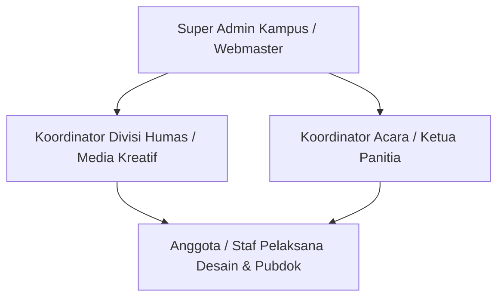
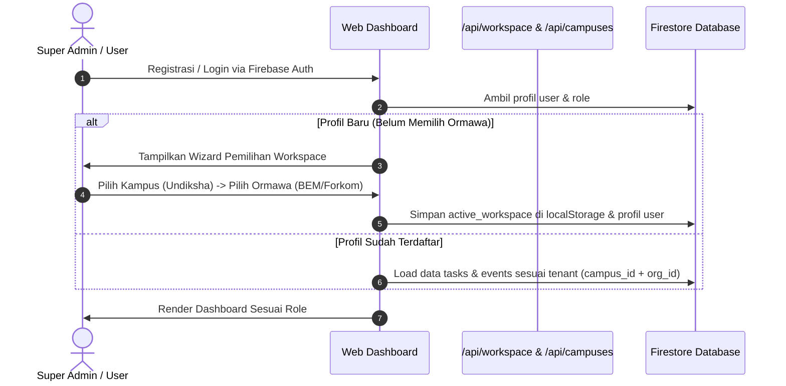
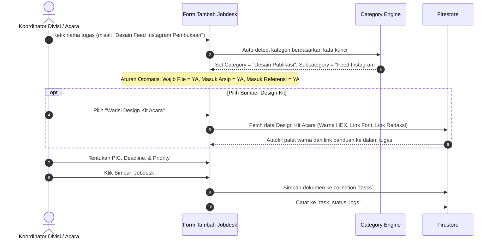
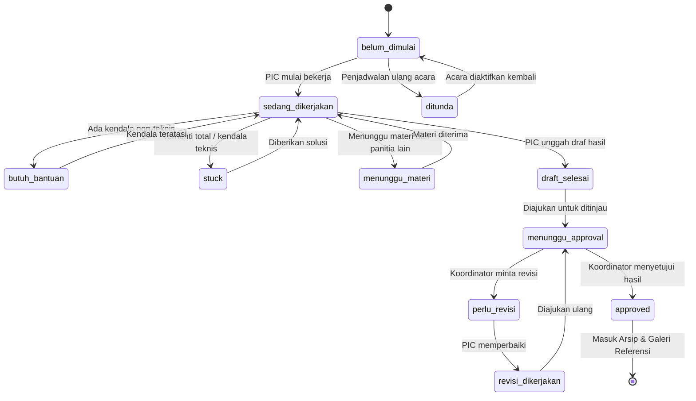

# DOKUMEN ANALISIS KOMPREHENSIF & BRAINSTORMING: JOBDEX.IN
> **Target Penggunaan:** Dokumen panduan dan konteks lengkap sistem untuk diunggah ke Google Gemini guna brainstorming arsitektur, audit teknis, dan perencanaan pengembangan fitur ke depan.  
> **Status Repositori:** Aktif (Tahap Transisi UI Modern SaaS & Multi-Tenant Stabilization)  
> **Versi Analisis:** 2.0 (Post-Multi-Tenant & Design Kit Integration)  
> **Tanggal Analisis:** Oktober 2026  

---

## DAFTAR ISI
1. [Ringkasan Eksekutif & Identitas Proyek](#1-ringkasan-eksekutif--identitas-proyek)
2. [Latar Belakang, Masalah, & Target Pengguna](#2-latar-belakang-masalah--target-pengguna)
3. [Arsitektur Sistem & Tech Stack Lengkap](#3-arsitektur-sistem--tech-stack-lengkap)
4. [Analisis Progres Saat Ini (Status Fitur & Milestone)](#4-analisis-progres-saat-ini-status-fitur--milestone)
5. [Analisis Pekerjaan Terakhir & Penanganan Error](#5-analisis-pekerjaan-terakhir--penanganan-error)
6. [Sistem Alur Kerja (Workflows) Lengkap](#6-sistem-alur-kerja-workflows-lengkap)
7. [Ekosistem Otomasi WhatsApp Bot (32+ Perintah)](#7-ekosistem-otomasi-whatsapp-bot-32-perintah)
8. [Arsitektur AI Copilot (Dual-Engine: DeepSeek + Gemini)](#8-arsitektur-ai-copilot-dual-engine-deepseek--gemini)
9. [Sistem Kurasi Arsip & Referensi Desain Dinamis](#9-sistem-kurasi-arsip--referensi-desain-dinamis)
10. [Agenda Brainstorming & Rekomendasi Pengembangan Masa Depan](#10-agenda-brainstorming--rekomendasi-pengembangan-masa-depan)

---

## 1. RINGKASAN EKSEKUTIF & IDENTITAS PROYEK

### 1.1 Apa Itu JobDex.in?
**JobDex.in** adalah platform SaaS manajemen tugas (*job desk*), kolaborasi tim kepanitiaan, kurasi aset desain, dan asisten pemantauan cerdas yang dirancang khusus untuk ekosistem organisasi mahasiswa (Ormawa: BEM, DPM, HMJ, UKM, serta Kepanitiaan Kampus). 

Fokus utamanya adalah memecahkan kompleksitas operasional divisi **Humas, Media Kreatif, Publikasi & Dokumentasi (Pubdok/Hubdok)** yang memiliki beban kerja konten visual, copywriting, koordinasi deadline ketat, serta pergantian pengurus tahunan (*regenerasi kepanitiaan*).

### 1.2 Quick Fact Sheet
* **Nama Produk:** JobDex.in (*Job Desk Indexer & Intelligence Network*)
* **Core Philosophy:** Menggabungkan fleksibilitas tabel Google Sheets, struktur dokumentasi Notion, kecepatan notifikasi instan WhatsApp, dan kemampuan ringkasan cerdas Large Language Model (DeepSeek & Google Gemini).
* **Target Lingkup Awal:** Universitas Pendidikan Ganesha (Undiksha) dengan entitas BEM REMA Undiksha dan Forum Komunikasi KIP-Kuliah (Forkom KIP) Undiksha, dirancang arsitektur multi-kampus (*multi-tenant*).
* **Lisensi / Tipe:** Proprietary / Web SaaS Application.

---

## 2. LATAR BELAKANG, MASALAH, & TARGET PENGGUNA

### 2.1 Problem Statement (Masalah Nyata di Lapangan)
Organisasi mahasiswa di Indonesia pada umumnya menghadapi inefisiensi yang akut dalam manajemen publikasi dan dokumentasi acara:

| Masalah Konvensional | Dampak Nyata di Lapangan | Solusi JobDex.in |
|---|---|---|
| **Spreadsheet Berantakan** | Google Sheets sering tertimpa, rumus rusak, tidak ada validasi file, dan sulit dipantau lewat smartphone. | Antarmuka web modern dengan kolom jobdesk terstruktur, kategori otomatis, dan validasi input. |
| **Pesan WhatsApp Tenggelam** | Penugasan via grup WA hilang di tumpukan ratusan chat harian. | Integrasi Bot WhatsApp dua arah (`!jobdex`), notifikasi broadcast otomatis, dan pengingat deadline terpusat. |
| **Bottleneck Tak Terdeteksi** | Koordinator tidak tahu anggota mana yang sedang *stuck* atau kekurangan materi sampai hari H. | Status task eksplisit (`stuck`, `butuh_bantuan`, `menunggu_materi`) dengan notifikasi *alert* langsung ke koordinator. |
| **Aset Desain Tercecer** | Hasil desain tersimpan di Google Drive pribadi anggota yang lulus, tautan hilang saat regenerasi. | Cloudinary Asset Hosting + Arsip Digital terpusat yang terindeks berdasarkan acara, divisi, dan tahun. |
| **Reinventing the Wheel** | Pengurus baru selalu membuat konsep dari nol karena tidak punya akses ke karya panitia tahun lalu. | Galeri Referensi Desain dinamis hasil kurasi otomatis dari jobdesk berstatus *approved*. |
| **Ketidaksinkronan Redaksi vs Desain** | Copywriter menulis di Word/Docs, desainer menata di Canva/Photoshop tanpa referensi teks tunggal. | Fitur *Copywriting & Design Kit* terintegrasi: satu task mengikat teks redaksi, palet warna, link font, dan aset visual. |

### 2.2 Target Pengguna (User Personas & Role-Based Access)



1. **Super Admin (`super_admin`):**
   * **Profil:** Pengelola teknis kampus/organisasi induk.
   * **Wewenang:** Konfigurasi multi-kampus, aktivasi ormawa, pengaturan gateway WhatsApp (BYO Gateway Fonnte/Wablas), manajemen akun, dan akses log audit sistem.
2. **Koordinator Divisi (`koordinator_divisi`):**
   * **Profil:** Ketua Divisi Humas & Media Kreatif.
   * **Wewenang:** Membuat jobdesk rutin divisi, mengelola anggota divisi, mengatur Design Kit Divisi, mendelegasikan tugas, memberikan *approval* / revisi pekerjaan, dan membaca laporan AI.
3. **Koordinator Acara (`koordinator_acara`):**
   * **Profil:** Ketua Pelaksana Acara / Koordinator Sie Pubdok Kepanitiaan Terkait.
   * **Wewenang:** Mengelola task khusus acara, menghubungkan grup WhatsApp acara ke sistem (`!jobdex hubungkan grup acara`), mengatur Design Kit Acara, dan menyetujui output pengerjaan.
4. **Anggota / Staf Pelaksana (`anggota`):**
   * **Profil:** Desainer grafis, video editor, fotografer, copywriter, atau staf operasional.
   * **Wewenang:** Melihat tugas pribadi (`!jobdex tugas saya` atau di dashboard), mengubah status pengerjaan, melaporkan kendala (*stuck*), mengunggah draf/file hasil desain, dan menandai checklist task.

---

## 3. ARSITEKTUR SISTEM & TECH STACK LENGKAP

JobDex.in dibangun menggunakan arsitektur serverless monorepo berbasis Next.js App Router dengan integrasi *cloud service* modern:

```
┌─────────────────────────────────────────────────────────────────────────┐
│                           CLIENT / BROWSER                              │
│       Next.js 16 (App Router) + React 19 + Tailwind CSS v4             │
│   Refined Clean SaaS UI / Neo-Design System + Lucide Icons + SweetAlert2 │
└────────────────────┬───────────────────────────────▲────────────────────┘
                     │ HTTPS / Webhook               │ Realtime Snapshot
                     ▼                               │
┌────────────────────────────────────────────────────┴────────────────────┐
│                    API ROUTE / SERVERLESS LAYER                         │
│  - /api/tasks, /api/events, /api/ormawas, /api/campuses, /api/workspace │
│  - /api/uploads/avatar & /api/uploads/task-result (Cloudinary SDK)     │
│  - /api/webhooks/fonnte & /api/webhooks/wablas (Inbound Parser)         │
│  - /api/cron/deadline-reminders (Scheduled Vercel Serverless Job)       │
│  - /api/ai/query (Dual-Engine AI Gateway + Prompt Sanitizer)           │
└─────────┬───────────────────┬───────────────────┬───────────────────────┘
          │                   │                   │
          ▼                   ▼                   ▼
┌──────────────────┐ ┌─────────────────┐ ┌────────────────────────────────┐
│ FIREBASE CLOUD   │ │ CLOUDINARY      │ │ AI & MESSAGING GATEWAYS        │
│ - Firebase Auth  │ │ - Media Storage │ │ - Primary AI: DeepSeek API     │
│ - Firestore NoSQL│ │ - CDN Delivery  │ │ - Fallback AI: Google Gemini   │
│ - Admin SDK      │ │ - Image Auto-   │ │ - In-Memory / Firestore Cache  │
│ - Security Rules │ │   Optimization  │ │ - WhatsApp: Fonnte & Wablas    │
└──────────────────┘ └─────────────────┘ └────────────────────────────────┘
```

### 3.1 Rincian Komponen Teknologi

| Layer | Teknologi / Library | Versi | Peran & Alasan Pemilihan |
|---|---|---|---|
| **Framework Utama** | Next.js (App Router) | `16.2.6` | Server-Side Rendering (SSR), Server Actions, Route Handlers dinamis, dan performa tinggi di Edge/Vercel. |
| **UI Library** | React | `19.2.4` | React Server Components (RSC), concurrent rendering, dan optimasi arsitektur frontend terbaru. |
| **Language** | TypeScript | `^5.0.0` | Type-safety ketat di seluruh interface database, webhook, and command parser. |
| **Styling** | Tailwind CSS + PostCSS | `^4.0.0` | Styling utilitas modern berkecepatan tinggi dengan CSS variables kustom (`#e1e2e3`, `#242424`, `#6349ea`). |
| **Database & Auth** | Google Firebase & Firestore | `^12.14.0` | NoSQL document-based database dengan kapabilitas Realtime Snapshot listeners dan integrasi Firebase Auth. |
| **Server Database** | Firebase Admin SDK | `^13.10.0` | Eksekusi transaksi serverless yang aman dengan hak penuh melewati batasan client rules untuk log dan cron. |
| **Asset Storage** | Cloudinary SDK | `^2.10.0` | Penyimpanan gambar hasil desain dan avatar profil dengan auto-scaling, transform webp, dan CDN global. |
| **WhatsApp Gateway** | Fonnte API & Wablas API | Custom REST | Penyedia pesan instan dengan arsitektur *Bring Your Own (BYO) Gateway* per Ormawa untuk redundansi. |
| **Mesin AI Utama** | DeepSeek API (`deepseek-chat`) | REST API | Mesin penalaran cerdas berbiaya hemat dan kontekstual tinggi untuk menjawab query data tugas & briefing. |
| **Mesin AI Sekunder** | Google Gemini API (`1.5/2.0 Flash`) | SDK / REST | Fallback model berkecepatan tinggi untuk pencarian kemiripan semantik dan fallback query. |
| **Job Scheduler** | Vercel Cron | Native Cron | Menjalankan jadwal audit deadline harian otomatis pada endpoint `/api/cron/deadline-reminders`. |
| **Reporting / Export**| SheetJS (`xlsx`) | `^0.18.5` | Export data jobdesk dan daftar hadir/anggota ke berkas Microsoft Excel spreadsheet secara instan. |

---

## 4. ANALISIS PROGRES SAAT INI (STATUS FITUR & MILESTONE)

Berdasarkan struktur kode, audit commit git, dan laporan pengujian yang ada di repositori:

### 4.1 Fitur yang Sudah Selesai & Berfungsi Penuh (Production-Ready)
1. **Multi-Tenant Campus & Ormawa Engine:**
   * Mendukung hirarki Kampus -> Ormawa -> Divisi -> Acara.
   * Tersedia navigasi *Workspace Nav Switcher* di header dan sidebar.
   * Default workspace disetel stabil pada **Universitas Pendidikan Ganesha (Undiksha)** dengan unit **BEM REMA Undiksha** dan **Forkom KIP Undiksha** serta divisi **Humas & Media Kreatif**.
2. **Sistem Jobdesk & Smart Categorization:**
   * 12 Kategori Utama dan ratusan subkategori otomatis mendeteksi apakah suatu tugas wajib upload file, wajib link sumber, atau sekadar log aktivitas.
   * Siklus status tugas 11-tingkat: dari `belum_dimulai`, `sedang_dikerjakan`, `butuh_bantuan`, `stuck`, `menunggu_materi`, `draft_selesai`, `perlu_revisi`, `revisi_dikerjakan`, `menunggu_approval`, `approved`, hingga `ditunda`.
3. **Design Kit System (Fase 26A):**
   * Penugasan jobdesk dapat mewarisi (*inherit*) konfigurasi Design Kit dari Acara atau Divisi: palet warna (HEX), arah visual (*visual direction*), catatan supergrafis, tautan redaksi (Google Docs), dan link referensi (Canva/Figma/Drive).
4. **WhatsApp Bot Otomasi Dua Arah (Fonnte & Wablas Gateway):**
   * Lebih dari 32 intent perintah terstruktur (`!jobdex ...`) mencakup pengecekan tugas, briefing, penggantian PIC, approval, minta revisi, hingga draf pembuatan tugas/acara baru dengan mekanisme *Two-Step Confirmation Preview* (PREVIEW ID).
   * Fitur Sandbox Test Mode & simulasi webhook untuk verifikasi payload tanpa harus menggunakan nomor WA fisik.
5. **Dual-Engine AI Assistant dengan Live Context Injection:**
   * Mesin AI membaca langsung snapshot data tugas, anggota, dan acara dari Firestore secara dinamis sebelum merespons pertanyaan pengguna.
   * Implementasi *In-Memory AI Response Cache* (`ai-cache.ts`) dengan TTL untuk menghemat kuota dan memangkas latency.
6. **Sistem Pengingat Deadline Otomatis (Cron Engine):**
   * Endpoint cron harian memeriksa tugas yang berisiko (H-3, H-1, Hari H, dan Overdue).
   * Mengirimkan pesan ringkasan (*digest notification*) ke grup WhatsApp acara atau nomor PIC terkait.

### 4.2 Pekerjaan yang Sedang Berjalan (In-Progress / Working Tree Changes)
Saat ini terdapat **46 file yang termodifikasi di working directory lokal (uncommitted)** yang fokus pada:
* **Redesain Antarmuka (Modern Clean SaaS Aesthetics):**
  Mengubah tema visual dari *bold high-contrast neobrutalism* (border hitam tebal 3px dan warna saturasi tinggi) menuju estetika SaaS modern yang elegan:
  - Palet warna lembut: border `#e1e2e3`, dark border `slate-800`, neutral background `#f7f7f8`, teks primer `#242424`, serta aksen violet `#6349ea` dan emerald `#19a874`.
  - Pembaruan komponen inti: `neo-sidebar.tsx`, `neo-topbar.tsx`, `role-dashboard-content.tsx`, `tasks-table.tsx`, `events-table.tsx`, `members-table.tsx`, dan halaman Landing Page (`src/app/page.tsx`).
* **Penyempurnaan Dialog Workspace & Setup Data Awal:**
  Pembersihan dummy data kampus luar (UI, ITB, UNUD, UGM) agar pengguna langsung disajikan data relevan Undiksha saat pertama kali membuka aplikasi.

### 4.3 Gap Teknis & Isu yang Masih Terbuka (Technical Debt & Backlog)
1. **Isu Multipart Form-Data pada Upload Endpoints (Temuan TestSprite):**
   * Sesuai laporan di `docs/TESTSPRITE_JOBDEXIN_REPORT.md`, endpoint `POST /api/uploads/avatar` dan `POST /api/uploads/task-result` mengalami kegagalan (HTTP 500) saat menerima payload multipart/form-data tertentu karena konfigurasi parser streaming internal atau kredensial Cloudinary yang belum terpasang sempurna di lingkungan pengujian.
2. **Peringatan React 19 / ESLint Linting:**
   * Terdapat 40 error ESLint (terutama aturan `react-hooks/set-state-in-effect` di beberapa komponen dialog seperti `add-ormawa-dialog.tsx`, `division-dialog.tsx`, `workspace-nav-switcher.tsx`, dan `workspace-context.tsx`). Panggilan `setState` langsung di dalam body `useEffect` perlu dirapikan untuk mencegah *cascading re-render*.
   * Penggunaan `any` di executor WhatsApp (`whatsapp-command-executor.ts` dan `whatsapp-task-command-executor.ts`) yang perlu didefinisikan tipe datanya secara eksplisit.
3. **Integrasi Google Drive API Langsung:**
   * Saat ini tautan Google Drive masih disimpan sebagai URL string manual; belum ada sinkronisasi otomatis menggunakan Google Drive API service account.

---

## 5. ANALISIS PEKERJAAN TERAKHIR & PENANGANAN ERROR

### 5.1 Masalah Terakhir yang Ditangani (Commit `5a06a5d`)
**Deskripsi Masalah:**
Pada commit `5a06a5d` (*fix(workspace): resolve Firestore data visibility for Forkom KIP Undiksha (main_org) and remove non-Undiksha campuses*), pengembang menyelesaikan masalah kritis di mana data tugas, acara, dan anggota milik organisasi **Forkom KIP Undiksha** tidak muncul atau terblokir di dashboard saat pengguna beralih ruang kerja (*workspace switcher*).

### 5.2 Akar Masalah (Root Cause)
1. **Konflik Tenant ID (Legacy vs Multi-Tenant):**  
   Sebelumnya, data Forkom KIP disimpan dengan identifier organisasi lama (`main_org`) atau `org-undiksha-forkom-kip`. Ketika sistem multi-tenant diterapkan, filter Firestore client dan Firestore Security Rules (`firestore.rules`) melakukan validasi ketat terhadap field `org_id` dan `campus_id`.
2. **Fallback Default Kampus Tidak Sesuai:**  
   Fungsi pembantu keamanan di Firestore rules memiliki fallback nilai `"ui"` (Universitas Indonesia) jika field `campus_id` tidak ditemukan pada dokumen pengguna:
   ```javascript
   // SEBELUMNYA (BUG):
   : ("univ_id" in data ? data.univ_id : ("univId" in data ? data.univId : "ui")));
   ```
   Hal ini menyebabkan aturan `matchesTenant()` menolak hak baca/tulis (*permission-denied*) bagi user Undiksha karena dianggap tidak cocok dengan tenant `"ui"`.
3. **Data Dummy Kampus Lain Mengaburkan Pengujian:**  
   Keberadaan data dummy UI, ITB, UNUD, dan UGM membuat filter query Firestore menjadi ambigu saat menghitung total metrik di dashboard.

### 5.3 Solusi Teknis yang Diterapkan
1. **Pembaruan Firestore Security Rules (`firestore.rules`):**
   - Menambahkan pengecekan kesetaraan tenant multi-id di fungsi `isSameOrg()` dan `isSameCampus()`:
     ```javascript
     function isSameOrg(docOrg, userOrg) {
       return docOrg == userOrg ||
         docOrg == "main_org" ||
         docOrg == "org-undiksha-forkom-kip" ||
         docOrg == "org-undiksha-bem" ||
         docOrg == "org-ui-bem" ||
         userOrg == "main_org" ||
         userOrg == "org-undiksha-forkom-kip" ||
         userOrg == "org-undiksha-bem" ||
         userOrg == "org-ui-bem";
     }
     ```
   - Mengubah fallback default kampus dari `"ui"` menjadi `"univ-undiksha"`.
   - Memberikan bypass akses baca/tulis bagi `super_admin` di level tenant check:
     ```javascript
     return isSuperAdmin() || (isSameOrg(docOrg, userOrg) && isSameCampus(docCampus, userCampus));
     ```
2. **Penyesuaian Query Layer di Frontend (`src/lib/firebase/`):**
   - File `tasks.ts`, `events.ts`, `members.ts`, dan `ai-context.ts` diperbarui agar menyertakan alias `main_org` ketika pengguna sedang berada di workspace Forkom KIP Undiksha.
3. **Pembersihan Dummy Data (`src/lib/workspace-dummy-data.ts`):**
   - Menghapus lebih dari 200 baris mock data non-Undiksha, sehingga sistem hanya memuat entitas Undiksha (BEM REMA Undiksha & Forkom KIP Undiksha) secara bersih dan konsisten.

---

## 6. SISTEM ALUR KERJA (WORKFLOWS) LENGKAP

Berikut adalah visualisasi dan penjelasan 8 pilar alur kerja utama JobDex.in:

### 6.1 Workflow 1: Onboarding & Hirarki Workspace Multi-Tenant


### 6.2 Workflow 2: Pembuatan Jobdesk & Pewarisan Design Kit


### 6.3 Workflow 3: Siklus Hidup Pengerjaan Tugas (Task Lifecycle)


### 6.4 Workflow 4: Upload Hasil & Integrasi Cloudinary
1. PIC membuka detail tugas di Dashboard atau melalui perintah WA `!jobdex upload hasil [kode] [link]`.
2. Jika melalui web, PIC mengunggah file gambar (JPG/PNG/WebP maks 10MB) atau menyertakan tautan Canva/Figma/Drive.
3. Request dikirim ke `POST /api/uploads/task-result` (memerlukan Firebase Auth Token).
4. Server memvalidasi tipe file dan ukuran, kemudian mengirim stream file ke Cloudinary folder `jobdex/task-results/`.
5. Cloudinary mengembalikan URL CDN yang aman (*secure_url*).
6. Server memperbarui dokumen `tasks` di Firestore: mengisi field `result_design_url`, mengubah status ke `menunggu_approval`, dan mencatat riwayat ke `task_status_logs`.

### 6.5 Workflow 5: Notifikasi Otomatis & Scheduled Deadline Cron
1. Setiap hari pada pukul 08.00 pagi WITA (atau sesuai konfigurasi Vercel Cron), endpoint `GET /api/cron/deadline-reminders?secret=...` dipanggil secara otomatis.
2. Server mengambil seluruh tugas aktif dari Firestore yang belum `approved`.
3. Server mengelompokkan tugas berdasarkan risiko waktu:
   * **Overdue:** Melewati tenggat waktu.
   * **Hari H:** Jatuh tempo hari ini.
   * **H-1:** Jatuh tempo besok.
   * **H-3:** Jatuh tempo dalam 3 hari ke depan.
4. Server mengelompokkan daftar tugas berdasarkan `whatsapp_group_id` yang terhubung ke acara atau divisi terkait.
5. Server membuat pesan rekap terformat (*digest reminder*) dan mengirimkannya melalui gateway WhatsApp (Fonnte/Wablas).
6. Catatan pengiriman direkam di collection `whatsapp_logs` untuk audit.

---

## 7. EKOSISTEM OTOMASI WHATSAPP BOT (32+ PERINTAH)

Bot WhatsApp JobDex.in berfungsi sebagai antarmuka operasional cepat tanpa perlu membuka browser.

### 7.1 Struktur Prefix & Gateway
* **Prefix Utama:** `!jobdex`
* **Arsitektur Gateway:** Mendukung multi-provider (Fonnte API sebagai primer, Wablas API sebagai alternatif).
* **Fitur Multi-Tenant Gateway (BYO Gateway):** Tiap Ormawa dapat mendaftarkan token API WhatsApp masing-masing melalui menu pengaturan workspace.

### 7.2 Matriks Perintah Utama Bot

| Kategori | Contoh Perintah WhatsApp | Hak Akses (Role) | Dampak pada Database |
|---|---|---|---|
| **Pemeriksaan Akun & Grup** | `!jobdex cek role saya`<br>`!jobdex cek grup`<br>`!jobdex cek pengirim` | Semua Anggota | Read-only (Mengecek binding nomor WA ke user dan grup ke acara) |
| **Monitoring & Briefing** | `!jobdex briefing`<br>`!jobdex siapa belum update`<br>`!jobdex deadline kritis` | Super Admin, Koord Divisi, Koord Acara | Read-only (Menghasilkan ringkasan statistik progres pengerjaan) |
| **Operasional Tugas Pribadi** | `!jobdex tugas saya`<br>`!jobdex detail task [kode]`<br>`!jobdex cek checklist [kode]` | Semua Anggota | Read-only (Menampilkan penugasan aktif dan item checklist) |
| **Eksekusi Status & Hasil** | `!jobdex update status [kode] in_progress`<br>`!jobdex upload hasil [kode] [url]`<br>`!jobdex tambah catatan [kode] [teks]` | PIC Tugas, Koordinator | Update dokumen `tasks` dan insert ke `task_status_logs` |
| **Review & Approval** | `!jobdex minta revisi [kode] [alasan]`<br>`!jobdex approve task [kode]` | Koordinator Divisi, Koordinator Acara, Super Admin | Mengubah status approval dan merekam reviewer di Firestore |
| **Perintah 2-Langkah (Draft / Preview)** | `!jobdex tambah jobdesk`<br>`!jobdex tambah acara`<br>`!jobdex ganti pic [kode] ke [nama]` | Koordinator | Sistem membuat draf sementara (`PREVIEW ID`) -> User wajib mengetik `!jobdex konfirmasi [PREVIEW ID]` |
| **Pencarian Aset & Tanya AI** | `!jobdex cari [kata kunci]`<br>`!jobdex [pertanyaan bebas]` | Semua Anggota | Melakukan pencarian di galeri referensi atau merutekan ke model DeepSeek/Gemini |

---

## 8. ARSITEKTUR AI COPILOT (DUAL-ENGINE: DEEPSEEK + GEMINI)

### 8.1 Strategi Dual-Engine
Sistem menerapkan prinsip *smart-routing* dan *fallback*:
1. **Primer:** **DeepSeek API (`deepseek-chat`)** dipilih untuk penalaran logika, pemahaman bahasa Indonesia santun ala organisasi mahasiswa, serta efisiensi biaya komputasi per token.
2. **Fallback:** **Google Gemini API (`gemini-1.5-flash` / `gemini-2.0-flash`)** siap menggantikan secara otomatis jika endpoint DeepSeek mengalami rate limit atau timeout.

### 8.2 Live Firestore Context Injection
AI pada JobDex.in bukan chatbot generik. Setiap request ke `/api/ai/query` atau pertanyaan bebas di WhatsApp diperkaya dengan konteks data langsung dari database:
* Daftar acara aktif dan tanggal pelaksanaan.
* Daftar anggota dan pembagian tugas per PIC.
* Statistik jumlah tugas: berapa yang berstatus `stuck`, `perlu_revisi`, atau mendekati deadline.
* Data dikompresi dan dipangkas secara cerdas (`truncateContext`) maksimal 8.000–12.000 karakter agar tidak melebihi jendela konteks.

### 8.3 Caching Layer
* Modul `src/lib/server/ai-cache.ts` menyimpan respons AI berbasis hash pertanyaan dan konteks dengan *Time-To-Live (TTL)* 60 menit. Pertanyaan identik seputar progres acara tidak akan menguras kuota token API berulang kali.

---

## 9. SISTEM KURASI ARSIP & REFERENSI DESAIN DINAMIS

Salah satu keunggulan utama JobDex.in adalah siklus kurasi konten otomatis:

```
[Jobdesk Selesai] ──► Status: APPROVED
                             │
                             ├────────────────────────────────┐
                             ▼                                ▼
                     [SISTEM ARSIP]                  [GALERI REFERENSI]
                 Semua output pengerjaan         Hanya output non-sensitif
                 masuk sebagai bukti historis    yang dapat diguna-ulang
                 dan akuntabilitas divisi.       oleh kepanitiaan tahun depan.
```

### 9.1 Filter Sensitivitas Data
Sistem mengelompokkan data ke dalam tiga tingkat keamanan:
1. **Normal:** Desain publikasi, poster, pamflet, flyer, banner, twibbon, template sertifikat, dan video teaser.  
   👉 **Otomatis direkomendasikan masuk Galeri Referensi.**
2. **Internal:** Laporan pertanggungjawaban (LPJ), notula rapat koordinasi, daftar inventaris perlengkapan.  
   👉 **Hanya masuk Arsip Internal Panitia.**
3. **Sensitive:** Bukti transfer pembayaran, data pribadi peserta (KTP/KTM/Nomor HP), surat penagihan dana sponsor.  
   👉 **Dilarang keras masuk Referensi publik.**

---

## 10. AGENDA BRAINSTORMING & REKOMENDASI PENGEMBANGAN MASA DEPAN

Bagian ini disiapkan secara khusus untuk dievaluasi dan didiskusikan bersama Google Gemini guna menentukan langkah ekspansi berikutnya:

### 10.1 Prioritas Jangka Pendek (Stabilisasi & Polishing)
* [ ] **Penyelesaian Masalah Upload Form-Data:**
  Menstandarkan handler `POST /api/uploads/avatar` dan `POST /api/uploads/task-result` agar mendukung parsing multi-part streaming yang andal di Vercel Serverless tanpa error HTTP 500.
* [ ] **Pembersihan Linting React 19:**
  Merefaktor pemanggilan `setState` di dalam `useEffect` pada `workspace-nav-switcher.tsx` dan dialog modal lainnya untuk mematuhi aturan strict rendering React 19.
* [ ] **Finalisasi Commit Redesain UI Modern SaaS:**
  Menyelesaikan staging dari 46 file yang saat ini termodifikasi di working tree dan merilis tampilan antarmuka modern yang bersih.

### 10.2 Topik Brainstorming Fitur Baru (Ide Ekspansi untuk Diskusi Gemini)

#### Topik 1: Direct Cloud Drive Sync (Google Drive API / Nextcloud)
* *Pertanyaan Brainstorming:* Bagaimana merancang sinkronisasi otomatis satu folder per acara di Google Drive secara background worker tanpa membebani serverless timeout Next.js?
* *Ide Solusi:* Menggunakan Google Service Account yang secara otomatis membuat struktur folder: `Tahun/Nama Acara/Divisi Humas/Hasil Desain/` saat acara baru dibuat.

#### Topik 2: Integrasi AI Vision untuk Quality Control Desain
* *Pertanyaan Brainstorming:* Bisakah Gemini 1.5 Pro / Flash Vision digunakan untuk mengaudit file hasil desain sebelum diajukan ke koordinator?
* *Potensi Pemanfaatan:* 
  - Mengecek apakah ukuran/resolusi sesuai standar feed IG (1080x1080 atau 1080x1350).
  - Mengecek keberadaan logo sponsor wajib dan logo ormawa.
  - Membaca apakah ada kesalahan ketik (*typo*) pada tanggal acara dan nama pembicara menggunakan Optical Character Recognition (OCR).

#### Topik 3: Gamifikasi Kinerja & Reputasi Anggota
* *Pertanyaan Brainstorming:* Bagaimana memotivasi anggota kepanitiaan agar menyelesaikan tugas sebelum deadline tanpa rasa tertekan?
* *Ide Solusi:* Sistem *Achievement Badge* (misal: "Speedy Designer", "Zero Revision Hero", "Task Master") dan skor keaktifan yang dapat diekspor menjadi sertifikat apresiasi panitia di akhir periode.

#### Topik 4: Ekspansi Multi-Kampus Publik (SaaS Self-Service Onboarding)
* *Pertanyaan Brainstorming:* Saat ini sistem dioptimalkan untuk Undiksha. Bagaimana arsitektur database jika dibuka untuk ratusan universitas di seluruh Indonesia?
* *Pertimbangan:* Isolasi tenant per kampus, *subdomain-based routing* (`undiksha.jobdex.in`, `ui.jobdex.in`), dan model monetisasi freemium untuk kas ormawa.

---

### Lampiran Dokumen Terkait di Repositori
* **PRD Lengkap:** [`PRD_JobDex.in.md`](file:///d:/Download/jobdescin/PRD_JobDex.in.md)
* **Dokumentasi WhatsApp Bot:** [`docs/WHATSAPP_COMMANDS.md`](file:///d:/Download/jobdescin/docs/WHATSAPP_COMMANDS.md)
* **Aturan Kategori & Arsip:** [`docs/JOBDEX_JOBDESK_CATEGORIES.md`](file:///d:/Download/jobdescin/docs/JOBDEX_JOBDESK_CATEGORIES.md)
* **Laporan Uji TestSprite:** [`docs/TESTSPRITE_JOBDEXIN_REPORT.md`](file:///d:/Download/jobdescin/docs/TESTSPRITE_JOBDEXIN_REPORT.md)
