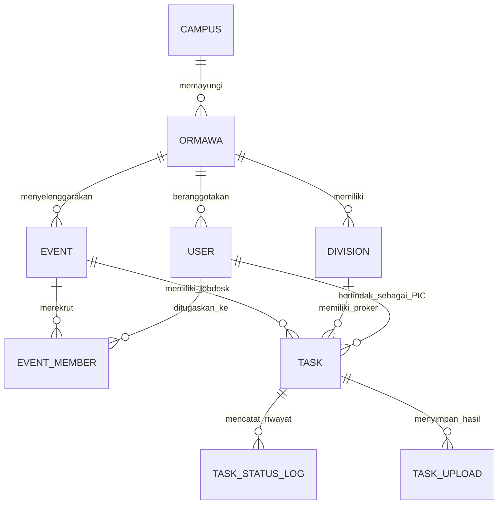
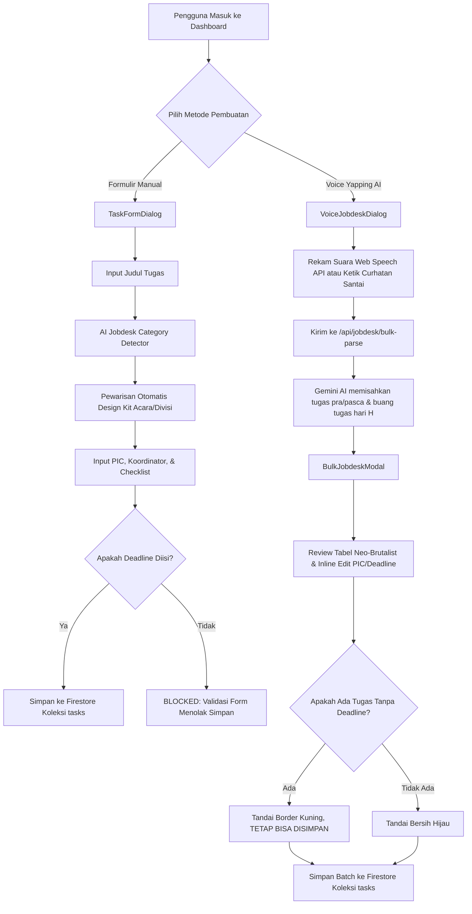
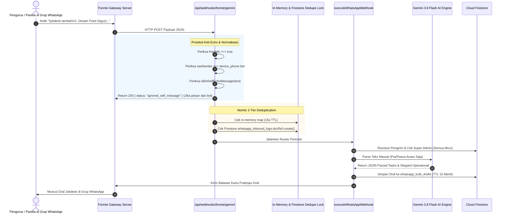
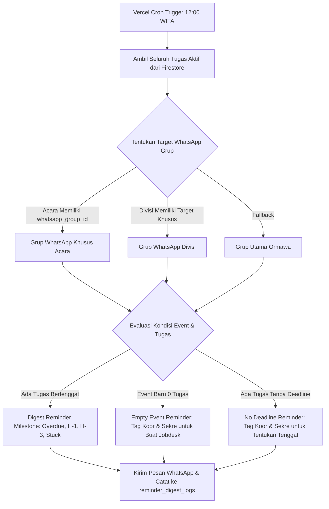
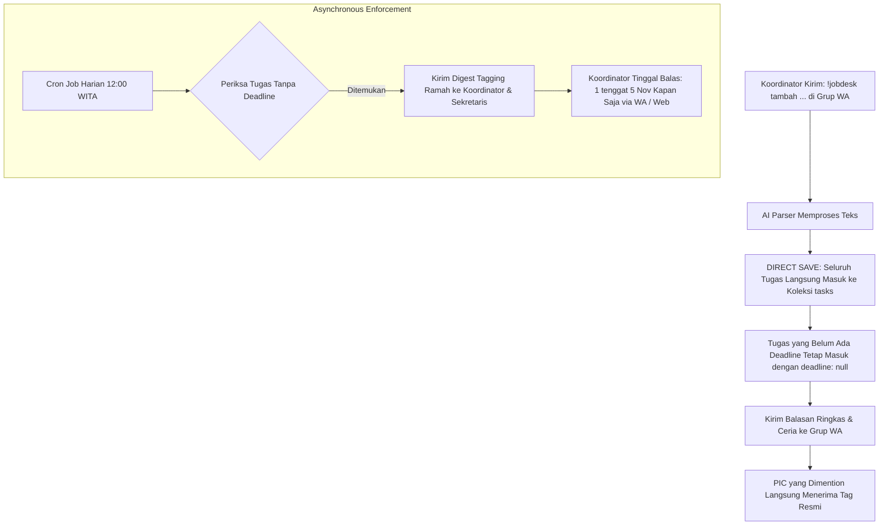

# AUDIT ARSITEKTUR SISTEM, SKEMA BASIS DATA, DAN WORKFLOW CODEBASE JOBDEX.IN
**Dokumentasi Komprehensif & Evaluasi Keseimbangan (Website vs WhatsApp Bot)**
*Tanggal Audit: 29 Oktober 2026 | Versi Sistem: JobDex.in 2.0 (Multi-Tenant & Academic Engine)*

---

## DAFTAR ISI
1. [BAB 1: Arsitektur Basis Data & Skema Firestore](#bab-1-arsitektur-basis-data--skema-firestore)
   - 1.1 Topologi Multi-Tenant & Identitas Data
   - 1.2 Daftar Koleksi & Subkoleksi Firestore
   - 1.3 Struktur Dokumen & Kamus Data (Field & Data Types)
   - 1.4 Matriks Relasi Entitas & Hirarki Hak Akses (RBAC)
2. [BAB 2: Workflow Website (End-to-End Dashboard)](#bab-2-workflow-website-end-to-end-dashboard)
   - 2.1 Alur Pembuatan & Pengelolaan Jobdesk
   - 2.2 Alur Kepanitiaan Acara & Manajemen Anggota
   - 2.3 Desain Kit & Pewarisan Aset Kreatif
   - 2.4 Sistem Sandbox & Pengaturan Multi-Gateway Web
3. [BAB 3: Workflow WhatsApp Bot (Webhook & Command Pipeline)](#bab-3-workflow-whatsapp-bot-webhook--command-pipeline)
   - 3.1 Pintu Masuk Webhook & Protokol Anti-Echo
   - 3.2 Pipeline Deduplikasi Pesan (Atomic 2-Tier Lock)
   - 3.3 Katalog Perintah & Eksekutor Bot
   - 3.4 Mekanisme Draf Sesi WhatsApp (`whatsapp_bulk_drafts`)
4. [BAB 4: Sistem Cronjob, Reminder, & Notifikasi Terjadwal](#bab-4-sistem-cronjob-reminder--notifikasi-terjadwal)
   - 4.1 Jadwal & Endpoint Cron Harian (Jam 12:00 WITA)
   - 4.2 Taksonomi Pengingat & Logika Pengelompokan Target
   - 4.3 Template Siaran WhatsApp Resmi
   - 4.4 Engine Pengiriman Multi-Provider (Fonnte / Green-API / Wablas)
5. [BAB 5: Gap Analysis & Rencana Perombakan (Web vs WhatsApp)](#bab-5-gap-analysis--rencana-perombakan-web-vs-whatsapp)
   - 5.1 Analisis Kesenjangan Fitur (Web vs WhatsApp)
   - 5.2 Titik Friksi & Bottleneck Alur Operasional
   - 5.3 Usulan Rekayasa Ulang: Alur *Direct Save* & Asynchronous Deadline
   - 5.4 Blueprint Format Visual Digest Harian (Status Simpel & Ramah)

---

## BAB 1: ARSITEKTUR BASIS DATA & SKEMA FIRESTORE

### 1.1 Topologi Multi-Tenant & Identitas Data
JobDex.in beroperasi di atas satu instansi Firebase Firestore dengan pendekatan **Logical Multi-Tenancy** untuk mengakomodasi berbagai institusi kampus, organisasi mahasiswa (Ormawa), kepanitiaan acara, hingga ruang kerja kelas akademik:
1. **Hierarki Organisasi Mahasiswa (Ormawa):**
   `Campus` (`campuses`) ➔ `Ormawa` (`ormawas`) ➔ `Division` (`divisions`) & `Event` (`events`) ➔ `Task` (`tasks`).
2. **Hierarki Ruang Kerja Kelas (Akademik):**
   `Workspace` (`workspaces` / `class_workspaces` bertipe `"kelas"`) ➔ `Task` (`tasks` bertipe `"tugas_kuliah"`).
3. **Penyelarasan ID Organisasi (Multi-Tenant Alias):**
   Di seluruh dokumen Firestore, sistem mendukung fallback multi-kunci untuk kompatibilitas data masa lalu:
   - `organization_id` / `org_id` / `orgId`: Mengikat data ke ormawa pemilik.
   - `campus_id` / `campusId` / `univ_id` / `univId`: Mengikat data ke universitas asal.
   - `workspace_id`: Mengikat data ke ruang kerja operasional aktif.

---

### 1.2 Daftar Koleksi & Subkoleksi Firestore

| No | Nama Koleksi / Subkoleksi | Path Firestore | Fungsi Utama |
|---|---|---|---|
| 1 | **Users** | `users/{userId}` | Master data profil pengguna, nomor WhatsApp, kredensial PIN bot, role global, dan role per-workspace. |
| 2 | **Tasks** | `tasks/{taskId}` | Master data seluruh jobdesk divisi, tugas kepanitiaan acara, dan tugas kuliah. |
| 3 | **Task Status Logs** | `tasks/{taskId}/status_logs/{logId}` | Subkoleksi riwayat audit perpindahan status tugas (siapa, kapan, status asal, status baru, catatan). |
| 4 | **Task Uploads** | `tasks/{taskId}/uploads/{uploadId}` | Subkoleksi riwayat file pengerjaan, aset Cloudinary, dan tautan hasil desain/dokumen. |
| 5 | **Events** | `events/{eventId}` | Master data acara/kepanitiaan, tanggal pelaksanaan, WhatsApp group binding, dan Event Design Kit. |
| 6 | **Event Members** | `events/{eventId}/event_members/{memberId}` | Subkoleksi keanggotaan panitia acara beserta peran spesifik kepanitiaan (`role_in_event`). |
| 7 | **Divisions** | `divisions/{divisionId}` | Master data divisi internal ormawa (misal: Kominfo, PSDM, Humas) dan Division Design Kit. |
| 8 | **Campuses** | `campuses/{campusId}` | Master data perguruan tinggi mitra (Undiksha, dsb.). |
| 9 | **Ormawas** | `ormawas/{ormawaId}` | Master data organisasi mahasiswa di bawah kampus tertentu. |
| 10 | **Ormawa Members** | `ormawa_members/{userId_orgId}` | Tabel perantara penugasan anggota ke organisasi mahasiswa. |
| 11 | **Ormawa Gateways** | `ormawa_whatsapp_gateways/{ormawaId}` | Konfigurasi BYO (Bring Your Own) token gateway WhatsApp per-ormawa. |
| 12 | **Workspaces** | `workspaces/{workspaceId}` | Konfigurasi ruang kerja kelas / ormawa, aturan pengingat, dan target grup siaran WhatsApp. |
| 13 | **Design References** | `design_references/{refId}` | Bank data referensi desain masa lalu, tautan Google Drive, dan pustaka aset visual. |
| 14 | **WhatsApp Bulk Drafts** | `whatsapp_bulk_drafts/{senderPhone}` | Sesi penyimpanan draf massal sementara yang dibuat via perintah bot WhatsApp (TTL 15 menit). |
| 15 | **WhatsApp Task Drafts** | `whatsapp_task_drafts/{senderPhone}` | Sesi draf interaksi pembuatan tugas tunggal atau voice note via WhatsApp. |
| 16 | **AI Command Previews** | `ai_command_previews/{code}` | Draf perintah interaktif WhatsApp yang membutuhkan konfirmasi PIN/kode (misal: `!konfirmasi <code>`). |
| 17 | **WhatsApp Inbound Logs** | `whatsapp_inbound_logs/{dedupeHash}` | Log deduplikasi pesan masuk WhatsApp berkecepatan tinggi dengan kunci atomik (TTL 15 detik). |
| 18 | **WhatsApp Dispatch Logs** | `whatsapp_logs/{logId}` | Log audit setiap pesan keluar yang dikirim bot melalui gateway WhatsApp. |
| 19 | **Wablas Incoming Debug** | `wablas_incoming_debug/{debugId}` | Log audit struktur payload mentah webhook untuk kebutuhan debugging pengirim & nomor anggota. |
| 20 | **AI Daily Usage** | `ai_daily_usage/{phone_YYYY-MM-DD}` | Penghitung kuota harian pemanggilan AI Gemini / DeepSeek per nomor pengguna WhatsApp. |
| 21 | **AI Logs** | `ai_logs/{logId}` | Log percakapan tanya jawab asisten AI cerdas (web dashboard & bot WA). |
| 22 | **System Settings** | `system_settings/{settingKey}` | Konfigurasi sistem global (dokumen kunci: `system_settings/whatsapp` untuk Sandbox mode). |
| 23 | **Reminder Digest Logs** | `reminder_digest_logs/{digestId}` | Catatan pengiriman rekap harian jam 12:00 WITA untuk mencegah spam ganda di hari yang sama. |

---

### 1.3 Struktur Dokumen & Kamus Data (Field & Data Types)

#### A. Dokumen `tasks` (Koleksi Inti Jobdesk)
```typescript
interface Task {
  id: string;                               // ID unik Firestore
  organization_id: string;                  // ID Ormawa pemilik (contoh: "org-undiksha-forkom-kip")
  campus_id?: string;                       // ID Kampus (contoh: "campus-undiksha")
  workspace_id?: string;                    // ID Workspace (contoh: "ws_ilkom_2024" atau ormawa ID)
  type: "divisi" | "acara" | "tugas_kuliah"; // Tipe entitas tugas
  division_id?: string;                     // ID Divisi (jika type == "divisi")
  event_id?: string;                        // ID Acara (jika type == "acara")
  name: string;                             // Judul tugas / jobdesk
  description: string;                      // Deskripsi lengkap & arahan pengerjaan
  pic_id: string;                           // User ID penanggung jawab utama (PIC)
  pic_ids?: string[];                       // Array User ID jika tugas dikerjakan banyak orang
  pic_names?: string[];                     // Nama-nama PIC (denormalisasi untuk performa cepat)
  coordinator_id: string;                   // User ID koordinator pemberi tugas
  deadline: Timestamp | string | null;      // Tenggat waktu (WITA UTC+8). BISA NULL jika belum ditentukan.
  status: TaskStatus;                       // Status progres pengerjaan
  priority: "rendah" | "sedang" | "tinggi" | "kritis"; // Tingkat urgensi tugas
  
  // Bidang Materi, Brief, & Panduan Visual
  copywriting: string;                      // Teks brief copywriting / isi postingan
  copywriting_docs_url: string;             // URL Google Docs materi naskah
  design_reference_url: string;             // URL referensi Canva / Pinterest / Figma
  drive_reference_url: string;              // URL folder Google Drive aset materi
  color_palette: string[];                  // Daftar kode warna hex (contoh: ["#003366", "#FFCC00"])
  visual_direction: string;                 // Catatan supergrafis & arahan visual
  
  // Bidang Multi-Link Dinamis (Fase 26A)
  redaction_links?: ReferenceLink[];        // Tautan naskah/dokumen multi-sumber
  design_ref_links?: ReferenceLink[];       // Tautan referensi desain multi-sumber
  drive_ref_links?: ReferenceLink[];        // Tautan folder drive multi-sumber
  design_kit_source?: "event" | "division" | "manual" | null; // Asal pewarisan tema desain

  // Bidang Review & Hasil
  result_design_url: string;                // URL hasil akhir pengerjaan
  approval_status: "pending" | "approved" | "need_revision"; // Status persetujuan
  approved_by?: string;                     // User ID pemberi approval
  approved_at?: Timestamp;                  // Waktu tugas disetujui
  revision_notes: string;                   // Catatan revisi dari koordinator
  stuck_notes: string;                      // Catatan kendala dari PIC

  // Bidang Checklist Interaktif
  checklist_items?: Array<{
    id: string;
    label: string;
    is_done: boolean;
    done_at?: Timestamp;
    done_by?: string;
  }>;

  // Metadata Sistem
  is_archived: boolean;                     // Status arsip
  created_by: string;                       // User ID atau nomor WhatsApp pembuat
  created_at: Timestamp;                    // Waktu pembuatan
  updated_at: Timestamp;                    // Waktu pembaruan terakhir
  brief_notified_at?: Timestamp;            // Waktu siaran "Brief Siap Kerjakan" terakhir
}
```

#### B. Dokumen `events` (Kepanitiaan Acara)
```typescript
interface Event {
  id: string;
  organization_id: string;
  name: string;                             // Nama kegiatan (contoh: "Forkom Goes to School 2026")
  description: string;
  event_date: Timestamp | string;           // Tanggal puncak acara
  coordinator_id: string;                   // User ID Ketua Panitia / Koordinator Acara
  secretary_id?: string;                    // User ID Sekretaris Acara
  status: "persiapan" | "berlangsung" | "selesai" | "dibatalkan";
  progress_percentage: number;              // Dihitung otomatis dari rasio tugas yang sudah approved
  
  // Routing Grup WhatsApp Khusus Acara (Fase 19C/20C)
  whatsapp_group_id?: string;               // ID Grup WhatsApp (contoh: "120363431421318562@g.us")
  whatsapp_group_name?: string;             // Nama tampilan grup
  whatsapp_group_verified?: boolean;        // Apakah grup sudah terverifikasi bot
  
  // Event Design Kit (Fase 26A)
  design_kit_color_palette?: string[];      // Palet warna resmi acara
  design_kit_visual_direction?: string;     // Moodboard / tema visual acara
  design_kit_supergraphic_notes?: string;   // Elemen grafis wajib (logo, maskot)
  design_kit_redaction_links?: ReferenceLink[]; // Tautan panduan naskah
  design_kit_design_reference_links?: ReferenceLink[]; // Tautan template Canva/Figma
  design_kit_drive_reference_links?: ReferenceLink[];  // Tautan Google Drive utama panitia
}
```

#### C. Dokumen `users` (Profil Pengguna & Hak Akses)
```typescript
interface UserProfile {
  id: string;                               // UID dari Firebase Authentication
  organization_id: string;                  // Ormawa asal
  name: string;                             // Nama lengkap anggota
  nickname?: string;                        // Nama panggilan santai (untuk matching AI)
  aliases?: string[];                       // Variasi nama panggilan (contoh: ["Agus", "Sumesta", "Tu Gus"])
  email: string;
  whatsapp_number: string;                  // Nomor HP WhatsApp canonical (format: "628xxx")
  role: "super_admin" | "koordinator_divisi" | "koordinator_acara" | "anggota" | "korti";
  division_id: string;                      // Divisi pokok anggota di ormawa
  avatar_url: string;
  is_active: boolean;                       // Status keaktifan akun
  whatsapp_command_pin?: string;            // PIN angka pengaman eksekusi bot WA
  workspace_roles?: Record<string, string>; // Hak akses spesifik per-workspace ({ "ws_ilkom_2024": "korti" })
}
```

---

### 1.4 Matriks Relasi Entitas & Hirarki Hak Akses (RBAC)



#### Hirarki Hak Akses (RBAC Logic di `src/lib/permissions.ts`):
1. **`super_admin`:**
   - Memiliki bypass absolut ke seluruh ormawa, divisi, acara, dan workspace kelas.
   - Dapat membuat, mengedit, menghapus, meng-approve, dan membatalkan seluruh tugas dan event.
   - Bebas kuota pembatasan harian AI di WhatsApp.
2. **`koordinator_acara` / Pemilik Acara (`coordinator_id` & `secretary_id`):**
   - Berhak penuh atas seluruh tugas yang memiliki `event_id` terkait.
   - Berhak memvalidasi approval hasil kerja (`approved`, `need_revision`), menentukan tenggat waktu, dan menyiarkan brief materi ke grup WhatsApp acara.
3. **`koordinator_divisi`:**
   - Berhak mengelola seluruh tugas divisi (`type: "divisi"`) yang berada di bawah `division_id` miliknya.
   - Jika ditugaskan ke suatu acara sebagai panitia biasa (`anggota_acara`), hak kelola pada acara tersebut dikunci agar tidak melangkahi koordinator acara.
4. **`anggota` (PIC):**
   - Hak akses operasional terbatas pada tugas di mana `pic_id === user.id` atau `user.id in pic_ids`.
   - Dapat memperbarui status progres (`sedang_dikerjakan`, `butuh_bantuan`, `draft_selesai`), mencentang checklist, mengunggah bukti pengerjaan/link desain, dan menambahkan catatan kendala (`stuck_notes`).
   - Tidak dapat meng-approve tugas sendiri.

---

## BAB 2: WORKFLOW WEBSITE (END-TO-END DASHBOARD)

### 2.1 Alur Pembuatan & Pengelolaan Jobdesk
Di dashboard website (`/dashboard/tasks` & `/dashboard/jobdesk`), terdapat dua pintu utama pembuatan jobdesk:



#### Perbandingan Validasi Deadline di Web:
* **Pada `TaskFormDialog` (Form Manual):**
  Validasi form bersikap **kaku**. Kode pada baris 621 menyatakan: `if (!picId || !coordinatorId || !deadline) { setError("PIC, koordinator, dan deadline wajib diisi."); return; }`. Pengguna dilarang menyimpan draf jika tanggal belum dipilih.
* **Pada `BulkJobdeskModal` (AI Voice / Bulk Import):**
  Validasi form bersikap **fleksibel**. Tugas tanpa deadline ditandai peringatan warna kuning, namun fungsi simpan batch tetap mengizinkan `deadline: null` masuk ke database Firestore.

---

### 2.2 Alur Kepanitiaan Acara & Manajemen Anggota
1. **Inisialisasi Acara (`/dashboard/events`):**
   - Koordinator atau admin membuat acara dengan menentukan nama acara, estimasi tanggal puncak, deskripsi, serta memilih Koordinator Utama dan Sekretaris.
   - Sistem menyediakan kolom tautan grup WhatsApp acara (`whatsapp_group_id`). Jika diisi (format `120363xxx@g.us`), seluruh interaksi bot dan siaran pengingat acara otomatis diarahkan ke grup tersebut.
2. **Pengisian Skuad Panitia (`/dashboard/events/[eventId]`):**
   - Menggunakan komponen `EventMembersManager`.
   - Anggota ditambahkan ke subkoleksi `events/{eventId}/event_members` dengan atribut `role_in_event` bebas (contoh: *Koordinator Sie Acara*, *Sekretaris*, *Anggota Sie Perlengkapan*).
   - Hak akses sekretaris dan koordinator otomatis terbaca oleh WhatsApp bot melalui pemindaian ganda (dokumen root acara dan subkoleksi `event_members`).

---

### 2.3 Desain Kit & Pewarisan Aset Kreatif
JobDex.in memiliki modul unik bernama **Design Kit Engine** yang berfungsi mengeliminasi pertanyaan berulang tim kreatif (*"Font-nya apa?", "Warnanya apa?", "Folder drive-nya di mana?"*):
* **Tingkat Acara (`Event Design Kit`):** Koordinator menetapkan palet warna hex, moodboard visual, dan folder Drive materi utama pada acara.
* **Tingkat Divisi (`Division Design Kit`):** Divisi memiliki panduan visual standar tahunan.
* **Pewarisan Otomatis ke Tugas (`Auto-Inheritance`):** Saat jobdesk baru dibuat untuk suatu acara, `TaskFormDialog` secara reaktif menyalin palet warna, tautan Drive, dan arahan visual acara ke dalam tugas tersebut tanpa perlu diketik ulang oleh pembuat tugas.

---

### 2.4 Sistem Sandbox & Pengaturan Multi-Gateway Web
* **Halaman Pengaturan (`/dashboard/settings/whatsapp`):**
  Menyediakan kendali terpusat terhadap modul WhatsApp.
* **Mekanisme Sandbox Global:**
  Dokumen `system_settings/whatsapp` menyimpan flag `isTestMode: boolean` dan `testGroupId: string`.
  Ketika mode Sandbox diaktifkan oleh Super Admin, seluruh lalu lintas pesan WhatsApp dari website maupun serverless cronjob **dialihkan secara paksa** ke grup pengujian (default: `120363406824082148@g.us`) dengan banner peringatan di bagian atas pesan. Hal ini menjamin grup panitia riil tidak akan terganggu saat developer sedang melakukan pengujian fitur.

---

## BAB 3: WORKFLOW WHATSAPP BOT (WEBHOOK & COMMAND PIPELINE)

### 3.1 Pintu Masuk Webhook & Protokol Anti-Echo

JobDex.in mendukung tiga gateway webhook WhatsApp: **Fonnte** (`/api/webhooks/fonnte/gemini`), **Green-API** (`/api/webhooks/green-api`), dan **Wablas** (`/api/webhooks/wablas/gemini`). Webhook Fonnte adalah saluran interaksi utama untuk perintah kepanitiaan ormawa.



#### Protokol Anti-Echo (Pencegahan Self-Trigger Bot):
Untuk mencegah bot membalas pesannya sendiri secara berulang (infinite loop), webhook menerapkan tiga lapis penyaring:
1. **`payload.fromMe` / `payload.from_me` Check:** Mengabaikan pesan yang memiliki atribut `fromMe === true`.
2. **Device Phone Matching:** Membandingkan nomor pengirim (`payload.member` / `rawSender`) dengan nomor perangkat bot yang terdaftar di sistem (`payload.device`, `FONNTE_DEVICE_ID`, `WABLAS_DEVICE_PHONE`). Jika identik, sistem langsung membalas `{ status: "ignored_self_message" }`.
3. **Bot Output Header Inspection (`isBotSelfEchoMessage`):** Memeriksa apakah teks diawali dengan header resmi keluaran bot, seperti `📋 *DRAF JOBDESK ACARA`, `🚀 *JOBDESK ACARA RESMI DITERBITKAN`, atau `✅ *Tenggat Jobdesk Berhasil Diperbarui`.

---

### 3.2 Pipeline Deduplikasi Pesan (Atomic 2-Tier Lock)
Fonnte dan provider WhatsApp lainnya sering mengirimkan payload webhook ganda (*network retry*) dalam rentang milidetik yang sama. JobDex mengatasinya dengan:
1. **Tier 1 (In-Memory Lock):** Kunci memori berkecepatan tinggi dengan TTL 15 detik menggunakan hash SHA-256 dari `provider|groupId|sender|uniqueMessageId|text`.
2. **Tier 2 (Firestore Distributed Lock):** Pembuatan dokumen atomik di koleksi `whatsapp_inbound_logs`. Jika dokumen sudah ada dan belum berusia 15 detik, pesan duplikat ditolak tanpa diproses ulang.

---

### 3.3 Katalog Perintah & Eksekutor Bot

Berikut adalah seluruh perintah aktif yang didukung bot WhatsApp JobDex saat ini:

| No | Perintah / Keyword | Hak Akses Minimal | Deskripsi & Tindakan Sistem |
|---|---|---|---|
| 1 | `!jobdesk tambah <teks>` / `!jobdex tambah` | Super Admin / Koordinator / Sekretaris | Membaca daftar teks tugas kepanitiaan, menyaring via AI (mengabaikan operasional hari H), dan membuat draf draf massal. |
| 2 | `!jobdesk acc` / `jobdesk acc` | Koordinator / Sekretaris Acara | Menyetujui draf massal dan menerbitkan seluruh tugas ke database Firestore (wajib memiliki deadline). |
| 3 | `!jobdesk acc paksa` | Koordinator / Sekretaris Acara | Memaksa persetujuan dan penerbitan draf meskipun sebagian tugas belum memiliki tenggat waktu. |
| 4 | `!jobdesk batal` | Koordinator / Sekretaris Acara | Membatalkan dan menghapus draf sesi yang sedang aktif. |
| 5 | *Percakapan Tenggat* (misal: `1 tenggat 5 Nov`) | Koordinator / Sekretaris Acara | Dievaluasi oleh AI parser untuk memperbarui tenggat waktu tugas tertentu dalam draf draf massal. |
| 6 | `!jobdesk summary` | Anggota Terdaftar | Menampilkan ringkasan progres jobdesk acara/divisi yang terhubung di grup WhatsApp tersebut. |
| 7 | `!tugas saya` / `tugas saya` | Anggota Terdaftar | Menampilkan daftar jobdesk personal yang sedang ditugaskan kepada pengirim pesan. |
| 8 | `!briefing` | Koordinator / Anggota | Menampilkan rekap tugas yang memerlukan perhatian segera atau sedang dalam status `menunggu_materi`. |
| 9 | `!siapa belum update` | Koordinator / Sekretaris | Menampilkan daftar PIC yang belum memperbarui progres tugasnya lebih dari 3 hari. |
| 10 | `!detail <nama/kode>` | Anggota Terdaftar | Membuka rincian lengkap tugas, brief, link drive, palet warna, dan catatan revisi. |
| 11 | `!upload <nama/kode> <link>` | PIC Tugas Terkait | Menyimpan tautan hasil kerja desain/dokumen dan mengubah status menjadi `menunggu_approval`. |
| 12 | `!status <nama/kode> <status>` | PIC / Koordinator | Memperbarui status tugas (`sedang_dikerjakan`, `butuh_bantuan`, `draft_selesai`, `stuck`). |
| 13 | `!revisi <nama/kode> <catatan>` | Koordinator / Sekretaris | Menolak draf hasil kerja dan mengembalikan status ke `perlu_revisi` disertai catatan perbaikan. |
| 14 | `!approve <nama/kode>` | Koordinator / Sekretaris | Menyetujui hasil kerja tugas dan menandainya sebagai `approved`. |
| 15 | `!catatan <nama/kode> <teks>` | PIC / Koordinator | Menambahkan catatan kendala atau progres baru pada log tugas. |
| 16 | `!ganti pic <nama/kode> <nama>` | Koordinator Acara | Mengalihkan tanggung jawab pengerjaan tugas ke anggota lain. |
| 17 | `!centang <nama/kode> <item>` | PIC Tugas Terkait | Mencentang salah satu sub-item checklist tugas kepanitiaan. |
| 18 | `!referensi <kata kunci>` | Anggota Terdaftar | Melakukan pencarian cerdas ke bank data referensi desain masa lalu di Firestore. |
| 19 | *Pesan Pertanyaan Umum (FAQ)* | Anggota Bebas | Dicocokkan secara instan via `faq-matcher.ts` menggunakan data lokal `data/faq-knowledge.json`. |
| 20 | *Pertanyaan Bebas / Fallback* | Anggota Terdaftar | Diteruskan ke Gemini / DeepSeek AI untuk dijawab sesuai konteks organisasi (dibatasi kuota harian). |

---

### 3.4 Mekanisme Draf Sesi WhatsApp (`whatsapp_bulk_drafts`)
* **Penyimpanan Hibrida (Memory + Firestore):**
  Draf bulk jobdesk disimpan pada koleksi `whatsapp_bulk_drafts/{cleanSender}` dengan cache paralel pada objek memori NodeJS runtime.
* **Masa Berlaku (TTL):**
  Draf memiliki TTL ketat selama **15 menit** (`BULK_DRAFT_TTL_MS = 15 * 60 * 1000`). Jika dalam 15 menit koordinator tidak mengetik `!jobdesk acc`, draf otomatis kedaluwarsa dan dihapus dari sistem.
* **Resolusi Otorisasi Multi-Profil:**
  Sistem mencari seluruh dokumen di koleksi `users` yang memiliki nomor WhatsApp yang cocok dengan pengirim. Jika salah satu akun memiliki peran `super_admin`, otorisasi langsung diberikan secara bypass.

---

## BAB 4: SISTEM CRONJOB, REMINDER, & NOTIFIKASI TERJADWAL

### 4.1 Jadwal & Endpoint Cron Harian (Jam 12:00 WITA)
* **Endpoint:** `/api/cron/deadline-reminders` (HTTP GET / POST).
* **Jadwal Eksekusi:** Setiap hari pukul **04:00 UTC** (ekivalen dengan **12:00 WITA** siang di Bali/Makassar).
* **Konfigurasi Vercel Cron (`vercel.json`):**
  ```json
  {
    "crons": [
      {
        "path": "/api/cron/deadline-reminders",
        "schedule": "0 4 * * *"
      }
    ]
  }
  ```
* **Otentikasi Pengaman:**
  Endpoint dilindungi oleh variabel lingkungan `CRON_SECRET`. Panggilan wajib menyertakan header `Authorization: Bearer <CRON_SECRET>` atau parameter URL `?secret=<CRON_SECRET>`.

---

### 4.2 Taksonomi Pengingat & Logika Pengelompokan Target
Cronjob melakukan pemindaian menyeluruh ke seluruh koleksi `tasks` yang berstatus belum selesai dan tidak diarsip, lalu membaginya ke dalam 3 jenis rekap:



#### Kategori Milestone Pengingat Tugas:
1. **🚨 Overdue (Lewat Tenggat):** Tugas yang batas waktunya telah lampau dan belum berstatus `approved`.
2. **🔥 Hari Ini (Due Today):** Tugas yang harus selesai pada hari H sebelum pukul 23:59 WITA.
3. **⚠️ H-1 (Besok):** Tugas dengan sisa waktu 24 jam.
4. **⏳ H-2 s/d H-3:** Pengingat berkala untuk persiapan pengerjaan awal.
5. **📌 Menunggu Approval:** Tugas yang sudah diunggah oleh PIC namun belum disetujui koordinator.
6. **⛔ Stuck / Butuh Bantuan:** Tugas di mana PIC menyatakan mengalami kendala teknis.

---

### 4.3 Template Siaran WhatsApp Resmi

#### A. Template Rekap Milestone Tugas Harian (Digest Reminder)
```text
📢 *PENGINGAT JOBDESK: FORKOM GOES TO SCHOOL*
Total: 3 tugas perlu perhatian hari ini (12:00 WITA):

🚨 *LEWAT TENGGAT (OVERDUE):*
1. *Membuat Desain Sertifikat Pemateri*
   👤 PIC: @628123456789 (Wardana)
   ⏰ Tenggat: Kemarin, 28 Okt 2026 (20:00 WITA)

🔥 *TENGGAT HARI INI:*
2. *Menyusun Rundown Acara Final*
   👤 PIC: @628987654321 (Darma)
   ⏰ Tenggat: Hari ini (23:59 WITA)

👉 Perbarui progres tugas Anda di: https://jobdexin.sumestawsome.xyz/dashboard/tasks
Atau balas bot dengan: *!status [nama tugas] [status]*
```

#### B. Template Event Baru Tanpa Tugas (`EMPTY_EVENT_DIGEST`)
```text
📋 *PENGINGAT KEPANITIAAN BARU: FORKOM GOES TO SCHOOL*

Halo @6285119459703 (Koordinator) & @6287798799068 (Sekretaris),
Kepanitiaan acara ini sudah terdaftar di sistem, namun *belum memiliki rincian jobdesk sama sekali*.

💡 *Cara cepat menambahkan jobdesk:*
Kirimkan daftar tugas panitia di grup ini dengan format:
*!jobdesk tambah*
1. Pamflet Acara (Wardana) - tenggat 5 Nov
2. RAB Acara (Darma) - tenggat 8 Nov
```

#### C. Template Tugas Tanpa Tenggat (`NO_DEADLINE_TASK_DIGEST`)
```text
⚠️ *PERHATIAN KOORDINATOR & SEKRETARIS: FORKOM GOES TO SCHOOL*

Ditemukan *2 jobdesk* yang belum memiliki tenggat waktu (deadline):
1. *Mendesain Virtual Background Acara* (PIC: Kak Cici)
2. *Menyiapkan Draft Surat Undangan* (PIC: Sila)

Koordinator atau Sekretaris wajib menentukan tenggat waktu agar tugas dapat dipantau oleh pengingat otomatis.

👉 Balas chat ini untuk mengisi tenggat:
*[nomor] tenggat [tanggal/jam]* (contoh: *1 tenggat 5 Nov 20:00, 2 tenggat 8 Nov*)
```

#### D. Template Brief Materi Siap Kerjakan (`JobdeskBriefBroadcast`)
```text
📢 *BRIEF JOBDESK SIAP DIKERJAKAN: FORKOM GOES TO SCHOOL*
Materi dan arahan untuk tugas berikut telah dilengkapi oleh *Putu Agus (Koordinator)*:

📌 *Jobdesk:* Desain Feed Instagram Pengumuman Pendaftaran
👤 *PIC:* @628123456789 (Wardana)
⏰ *Tenggat:* Kamis, 5 November 2026 (20:00 WITA)
🎯 *Prioritas:* Tinggi 🔴

📝 *Brief Materi / Copywriting:*
Pendaftaran Forkom Goes to School resmi dibuka mulai 1-10 November 2026. Sasaran siswa SMA/SMK se-Bali.

🎨 *Palet Warna:* #003366, #FFCC00, #FFFFFF
📁 *Folder Drive Materi:* https://drive.google.com/drive/folders/xyz
📌 *Referensi Desain:* https://canva.com/design/xyz

Halo rekan PIC, materi di atas sudah siap dieksekusi. Semangat bertugas! 💪🔥
```

---

### 4.4 Engine Pengiriman Multi-Provider
Pengiriman pesan WhatsApp dipusatkan pada fungsi `sendWhatsAppMessage` di `src/lib/server/whatsapp/index.ts`:
1. **Multi-Tenant Gateway Routing:** Jika tugas terikat pada suatu Ormawa yang memiliki konfigurasi di `ormawa_whatsapp_gateways`, pesan dikirim menggunakan token Fonnte/Wablas milik ormawa tersebut. Jika tidak, sistem menggunakan gateway global dari file `.env`.
2. **Sandbox Interception:** Jika mode sandbox aktif, seluruh target dialihkan ke nomor grup pengujian sandbox.
3. **Official WhatsApp Mentions:** Array nomor HP internasional (`628xxx`) pada properti `mentions` diteruskan ke provider gateway sehingga menghasilkan *blue mention tag* resmi di aplikasi WhatsApp pengguna.

---

## BAB 5: GAP ANALYSIS & RENCANA PEROMBAKAN (WEB VS WHATSAPP)

### 5.1 Analisis Kesenjangan Fitur (Web vs WhatsApp)

| Area Fungsionalitas | Dashboard Website | Bot WhatsApp | Status Keseimbangan |
|---|---|---|---|
| **Pembuatan Bulk Jobdesk** | Tersedia via modal AI Voice / Yapping dengan tabel preview interaktif. | Tersedia via perintah teks `!jobdesk tambah`. | **Seimbang**. Namun di WA dibatasi masa tunggu 15 menit. |
| **Validasi Tugas Tanpa Deadline** | Di form manual **DIBLOKIR**, di modal bulk **DIIZINKAN**. | Diizinkan via perintah khusus `!jobdesk acc paksa`, namun **DIBLOKIR** pada `acc` biasa. | **Tidak Konsisten**. Menimbulkan kebingungan pengguna. |
| **Pengelolaan Materi / Brief** | Sangat lengkap (multi-link, upload file visual, color picker, rich textarea). | Terbatas pada perintah baca (`!detail`) dan notifikasi siaran saat diperbarui. | **Wajar**. Web optimal untuk input kompleks, WA optimal untuk konsumsi cepat. |
| **Pembaruan Status & Upload Hasil** | Lengkap dengan dialog konfirmasi, history upload Cloudinary, dan checklist view. | Lengkap via command singkat (`!status`, `!upload`, `!centang`). | **Sangat Baik**. Mobile-first workflow tercapai. |
| **Approval / Revisi Koordinator** | Tombol visual satu klik (Approve / Request Revision) dengan dialog input catatan. | Tersedia via `!approve` dan `!revisi`. | **Seimbang**. |
| **Pencarian Referensi Desain** | Galeri visual (thumbnail grid, filter kategori, preview kanvas). | Tersedia via teks (`!referensi <kata kunci>`). | **Wajar**. |

---

### 5.2 Titik Friksi & Bottleneck Alur Operasional

Berdasarkan audit mendalam terhadap kode dan interaksi pengguna, ditemukan **3 titik friksi utama**:

#### 1. Friksi Draf Sementara (`whatsapp_bulk_drafts`) & Barrier Perintah `!jobdesk acc`
* **Masalah:** Saat koordinator mengirim teks daftar jobdesk di grup WhatsApp, tugas **tidak langsung tersimpan** ke database. Sistem menahannya di koleksi sementara `whatsapp_bulk_drafts` dan mewajibkan koordinator mengetik `!jobdesk acc` dalam waktu 15 menit.
* **Dampak Buruk:**
  - Koordinator sering mengira tugas sudah terdaftar hanya dengan mengirim teks tugas.
  - Jika koordinator teralihkan urusan lain selama 15 menit, draf kedaluwarsa dan terhapus otomatis, memaksa koordinator mengulang pengiriman teks dari awal.
  - Sesi draf terikat pada nomor pengirim atau satu grup, sehingga jika ada 2 koordinator yang berdiskusi di grup, terjadi tabrakan *state*.

#### 2. Friksi Pemblokiran Tugas Tanpa Tenggat Waktu (*Rigid Deadline Gatekeeper*)
* **Masalah:** Sistem secara agresif menolak `!jobdesk acc` jika ada satu saja tugas yang belum memiliki tanggal deadline (kecuali koordinator mengetahui sintaks rahasia `!jobdesk acc paksa`).
* **Dampak Buruk:**
  - Dalam dinamika kepanitiaan riil di kampus, koordinator biasanya membagi nama tugas dan PIC terlebih dahulu saat rapat pembentukan panitia. Tanggal tenggat pasti sering kali baru diputuskan beberapa hari setelahnya.
  - Pemblokiran ini menghentikan laju kerja (*work stoppage*) dan memicu rasa frustrasi bagi pengurus yang baru pertama kali menggunakan JobDex.

#### 3. Fragmentasi Format Informasi di WhatsApp (Pesan Terlalu Panjang)
* **Masalah:** Format pesan bot sering kali mengirim ulang seluruh kartu tugas draf (misal 11 tugas berturut-turut dengan teks panjang), memenuhi layar chat grup (*chat flooding*).

---

### 5.3 Usulan Rekayasa Ulang: Alur *Direct Save* & Asynchronous Deadline

Untuk menghilangkan friksi di atas, berikut adalah cetak biru arsitektur alur baru yang diusulkan untuk refactor berikutnya:



#### Keuntungan Alur *Direct Save*:
1. **Zero Barrier:** Tidak ada lagi konsep kedaluwarsa 15 menit atau draf hilang. Sekali koordinator mengirim perintah, data 100% aman tersimpan di Firestore.
2. **Fleksibilitas Tinggi:** Koordinator bebas menentukan deadline nanti melalui web dashboard atau cukup membalas pesan bot kapan saja tanpa dibatasi waktu.
3. **Pemberdayaan Cronjob Harian:** Alih-alih memblokir di gerbang awal, tugas penagihan deadline diserahkan sepenuhnya ke Cronjob jam 12:00 WITA yang sudah berjalan otomatis setiap hari.

---

### 5.4 Blueprint Format Visual Digest Harian (Status Simpel & Ramah)

Alih-alih teks kartu yang panjang dan kaku, format laporan rekap harian jam 12:00 siang diusulkan menggunakan indikator visual berbasis warna/emoji yang bersih, profesional, dan mudah dipindai dengan mata dalam 3 detik:

```text
📊 *STATUS JOBDESK KEPANITIAAN: FORKOM GOES TO SCHOOL*
Update harian otomatis sistem JobDex.in (Kamis, 29 Oktober 2026):

❌ *BELUM DIMULAI (3)*
• Mendesain Pamflet Utama — PIC: @628123456789 (Wardana) | ⏰ 5 Nov
• Menyusun Anggaran Biaya (RAB) — PIC: @628987654321 (Darma) | ⏰ 8 Nov
• Koordinasi Tempat & Izin — PIC: @6285119459703 (Putu) | ⏰ 10 Nov

🟡 *SEDANG DIKERJAKAN (2)*
• Pembuatan Naskah Sambutan — PIC: Kak Sila | ⏰ Besok (20:00 WITA)
• Pembuatan Virtual Background — PIC: Kak Cici | ⏰ 6 Nov

✅ *SELESAI / APPROVED (1)*
• Pembuatan Logo Resmi Acara — PIC: Anin

──────────────────────────────
⚠️ *Pemberitahuan Khusus Koordinator & Sekretaris:*
Terdapat *1 tugas* yang belum memiliki tenggat waktu:
👉 *List Kebutuhan Konsumsi Acara* (PIC: Ipang)
Mohon bantu tentukan batas waktunya ya @6285119459703 (Koordinator) agar panitia dapat membagi prioritas kerja!

💡 *Update progres via WA:* Ketik *!status [nama tugas] [selesai/proses]*
👉 *Dashboard lengkap:* https://jobdexin.sumestawsome.xyz/dashboard/tasks
```

---
*Laporan audit arsitektur ini disusun sebagai acuan teknis resmi bagi tim pengembang JobDex.in untuk memandu iterasi dan perampingan kode sistem pada fase pengembangan berikutnya.*

